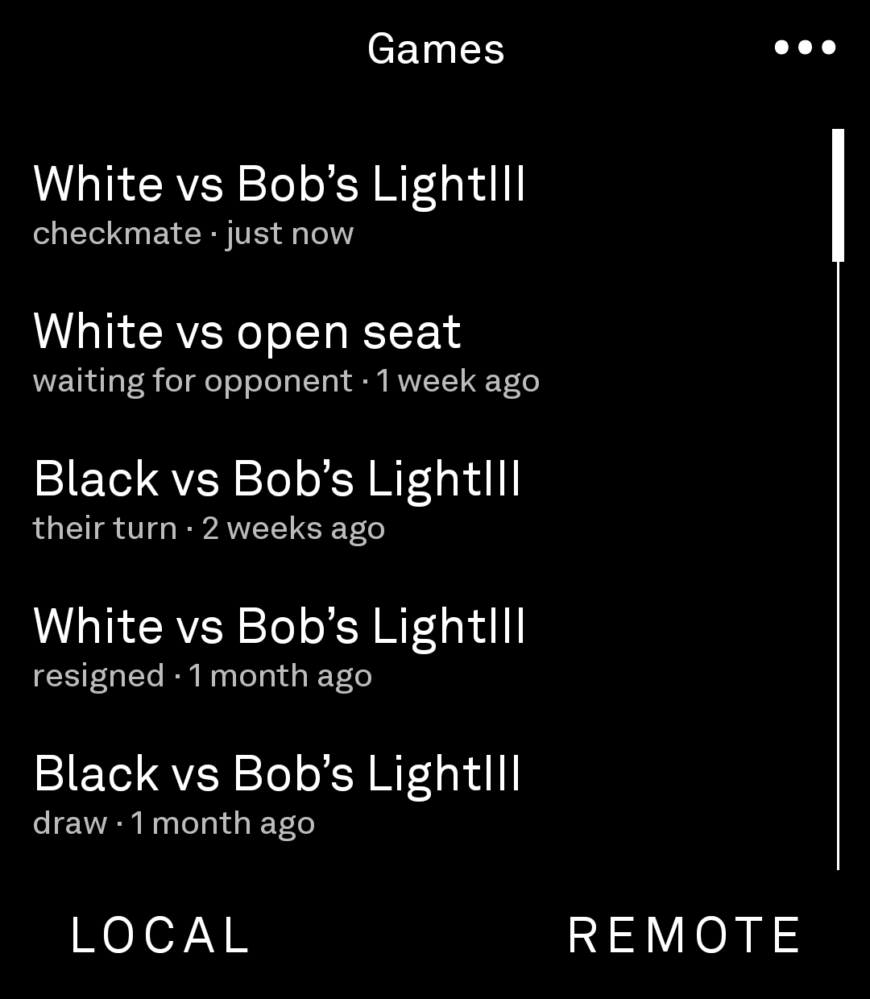
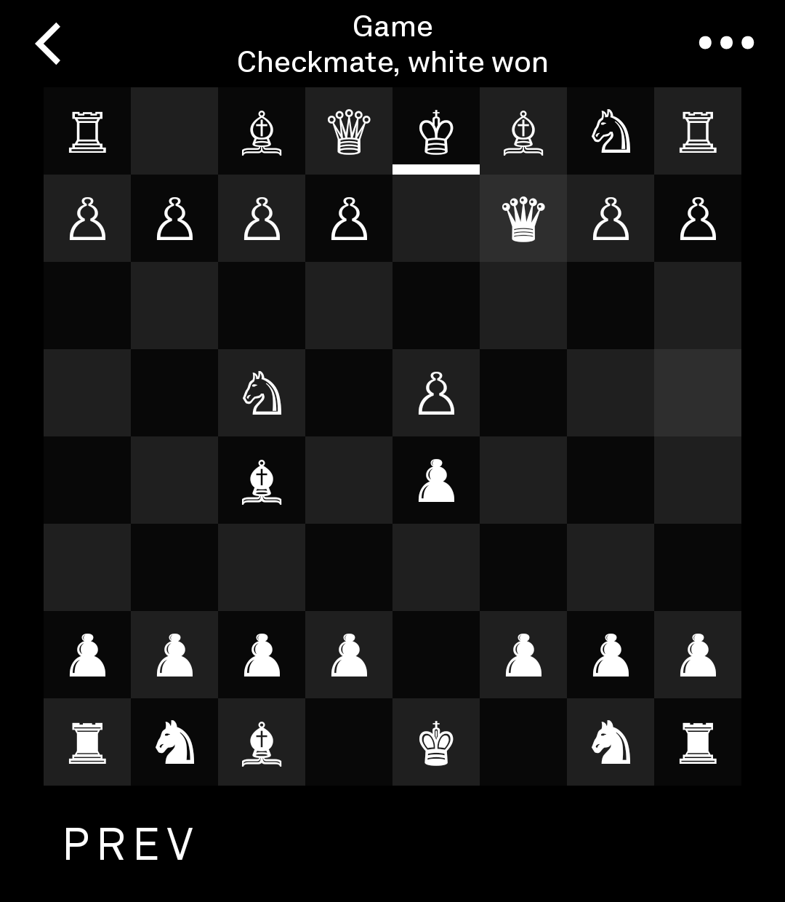
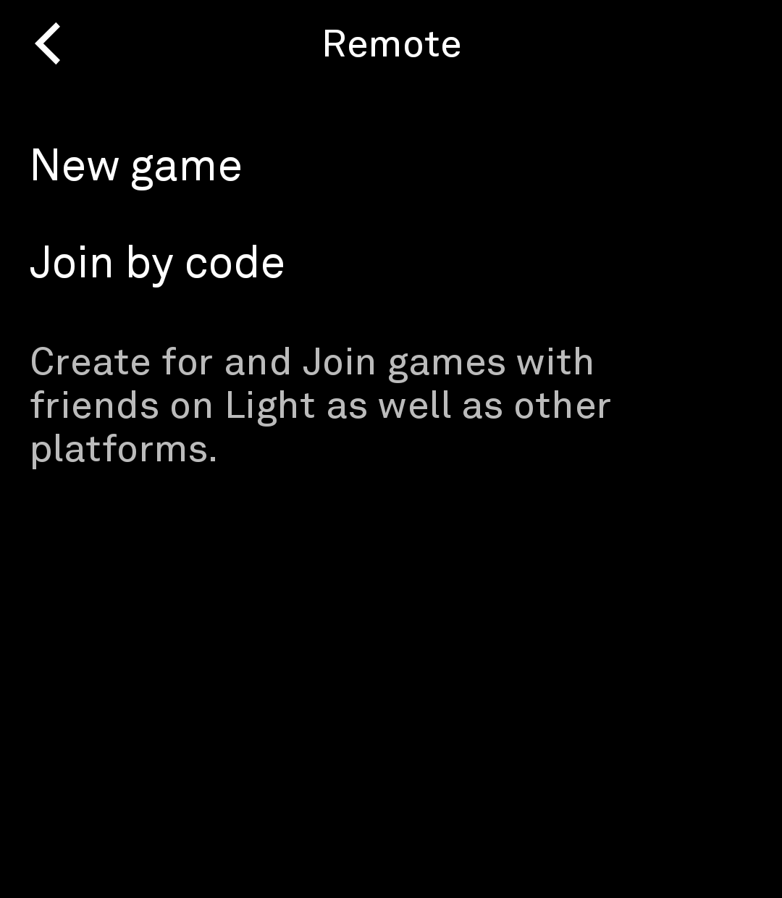
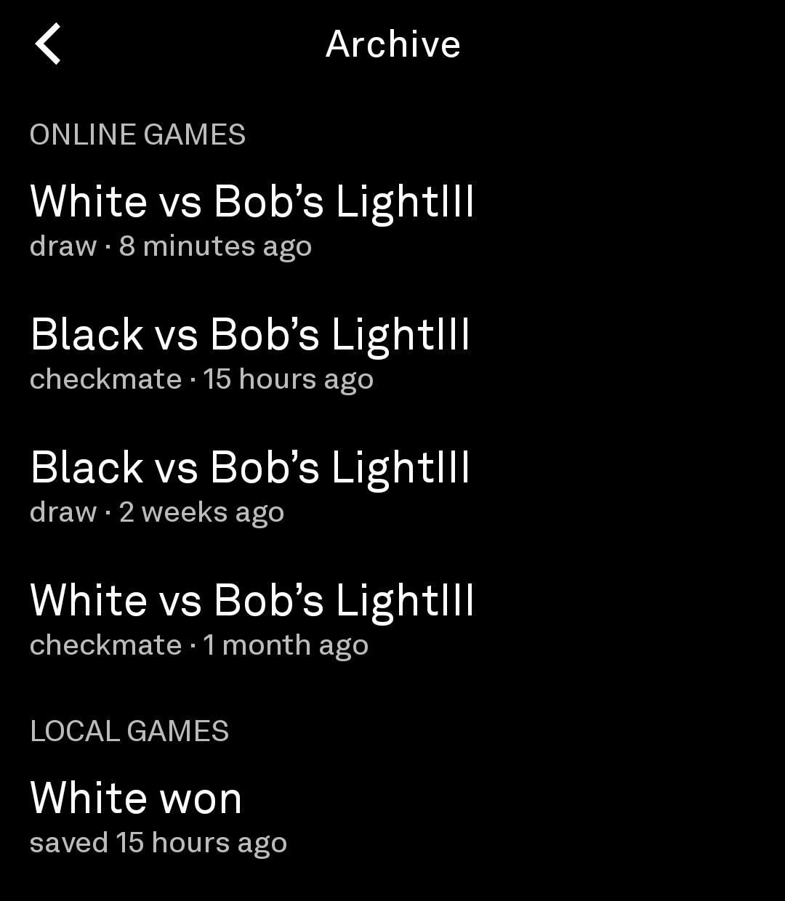
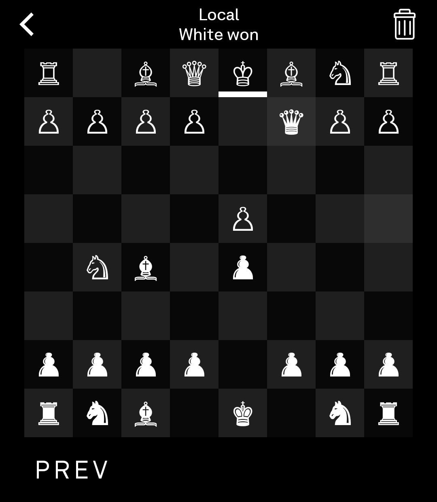

# Flamingo Chess

**Plain chess for the Light Phone III.** No engine, no ratings, no feed, no ads — a board, a
friend, and your move.

<p>
  
  
  
</p>

The Light Phone is made to be used as little as possible, and chess by correspondence fits it
perfectly: make your move, put the phone away, and pick it up again when your friend has
answered. A game can last ten minutes or two weeks — it waits for you.

## Play a friend, wherever they are

Tap **REMOTE**, then **New game**, choose white or black, and Flamingo Chess hands you a
five-letter code like `ADKRF`. Text it to a friend. They pick **Join by code**, type the
letters, and the game is on.

While you both have the game open, moves arrive the moment they are made. When you don't, the
game simply waits — the Games list tells you whose turn it is, and how long it has been.

## Or the person across the table

Tap **LOCAL** for two players on one phone — no connection needed. After every move the board
fades and turns around to face the other player. Moved the wrong piece? Take it back. Done?
Reset the board and play again.

## Everything a game needs

- **Offer a draw**, accept or decline one, or **resign** — from the game actions behind the
  ellipsis.
- Checkmate, stalemate, threefold repetition, the fifty-move rule and insufficient material are
  all recognized, and the game says how it ended.
- A king in check is marked. The last move can be shaded on the board — every last move, only
  your opponent's, or none (**Info → Board**).
- You play under a name like `blueberry764`, so a game reads "blueberry764 vs orange489". Change
  yours under **Info → Account**.

## Keep the games worth keeping

Finished games go to **Info → Archive**: online games you archive from their game actions, and
local games you save when they end. Step back through any finished game, move by move, with
**PREV** and **NEXT**.

<p>
  
  
</p>

## Platform Compatibility

Flamingo Chess is on the App Store, too —
**[Flamingo Chess for iPhone and iPad](https://apps.apple.com/us/app/checkmate/id6767338427)**,
which also plays right inside Messages.

Both apps share the same games. Start a game on your Light Phone and send the code to a friend
with an iPhone: they join it from the Flamingo Chess app, and you play the same game, live, each
on your own phone. It works the other way round as well — your friend starts a game on their
iPhone, and you enter their code under **REMOTE → Join by code**.

## Privacy

- No account to create, no sign-up, nothing tracked. Flamingo Chess collects no personal
  information.
- Online moves, draw offers and resignations are stored on the Flamingo Chess server so both of
  you can see the game. Games and their moves are publicly accessible, and so is your display
  name — don't make it your real name.
- Local games never leave your phone.
- Your name is tied to your phone. A new phone starts fresh, with a new name.

The full Terms of Service and Privacy Policy are in **Info**.

## Under the hood

Flamingo Chess is a community tool for LightOS, built on Light's
[light-sdk](https://github.com/lightphone/light-sdk) and open source like every community tool.
This repository is a fork of it: Light's modules (`sdk/`, `plugin/`, `lint-rules/`, `builder/`,
`examples/`) stay as they are upstream, and everything Flamingo Chess lives in [`tool/`](tool):

- `dev.neoneon.flamingo` — the tool itself: its screens, the local game, and the client for the
  Flamingo Chess server at `neoneon.dev` (HTTP, plus a WebSocket for live moves).
- `dev.neoneon.chesskit` — the chess engine: board, move legality, and FEN, SAN, LAN and PGN —
  see [docs/chesskit.md](docs/chesskit.md).

```bash
./gradlew :tool:test           # unit tests, including the engine's perft suite
./gradlew :tool:assembleDebug  # a debug APK
```

Run it on a Light Phone III, or on an Android emulator running Light's LightOS emulator app
([docs/system_app](docs/system_app)). An emulator that feels like an LPIII is 1080 × 1240, 3.92",
API 34, without Google Play Services. [CLAUDE.md](CLAUDE.md) has the architecture notes, and
Light's own guide to building tools is the
[light-sdk README](https://github.com/lightphone/light-sdk#readme) and [docs](docs).

## License

[MIT](LICENSE).
